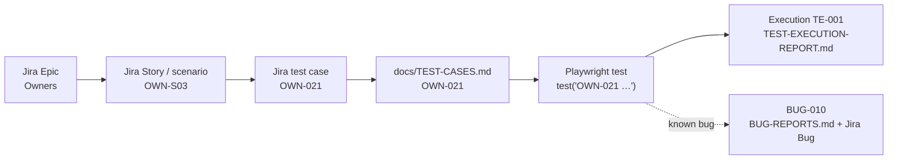

# PetClinic QA Portfolio – Manual QA + Playwright Automation

End-to-end QA project for the **PetClinic** web application: a test plan, 39 test scenarios,
123 documented test cases, 17 confirmed bug reports with evidence, a full execution report and a
traceability matrix. All of it is organised for **Jira** and backed by a **Playwright +
TypeScript** suite that automates 120 of the 123 test cases.

> **Context.** This is a learning and portfolio project. It started from the practice template of
> Bondar Academy's [*Playwright UI Testing Mastery*](https://bondaracademy.com/programs/playwright-ui-testing-mastery)
> program and was extended into a complete QA project. The application under test is the
> academy's public demo site; every bug and result in this repository was observed on it.

## At a glance

| | |
|---|---|
| **Application under test** | [PetClinic](https://petclinic.bondaracademy.com) (Angular SPA) and its REST API |
| **Test cases** | 123 in 12 areas – 120 automated, 3 manual |
| **Automated tests** | 139 Playwright tests in 15 spec files; 209 test runs across 5 browser/device projects |
| **Latest full run** (2026-11-02) | 180 passed · 29 failed because of open, confirmed bugs · **0 unexpected failures** |
| **Bugs** | 17 confirmed (1 Critical, 1 Major, 8 Minor, 7 Trivial) + 5 observations |
| **Testing types** | Functional, negative, boundary, regression, end-to-end, API, accessibility (WCAG 2.1 A/AA), non-invasive security, responsive, cross-browser, exploratory |
| **Tools** | Playwright 1.64, TypeScript, @axe-core/playwright, Node.js, Jira (CSV import), Git/GitHub |

**Start here:** [QA summary](docs/QA-SUMMARY.md) · [Test plan](docs/TEST-PLAN.md) ·
[Test cases](docs/TEST-CASES.md) · [Bug reports](docs/BUG-REPORTS.md) ·
[Traceability matrix](docs/TRACEABILITY-MATRIX.md) · [Jira structure](docs/jira/README.md)

## How Jira, the documentation and Playwright connect

Every artifact uses the **same IDs**. A test case such as `OWN-021` has the same ID in the
documentation, in the Jira issue summary and in the Playwright test title. The bug it finds,
`BUG-010`, is attached to that test as an annotation in the Playwright report and is linked to it
in Jira.



| Layer | Where | What |
|---|---|---|
| Test management (Jira) | [`docs/jira/`](docs/jira/README.md) | 12 Epics, 39 Stories, 123 test cases, 17 Bugs, 5 observations, 1 execution, 14 recommended tests – as a CSV import file, with the import guide and an issue ↔ file mapping |
| Manual QA documentation | [`docs/`](docs/README.md) | Plan, scenarios, test cases, coverage, bugs, execution report, traceability, summary |
| Automation (Playwright) | [`tests/`](tests), [`pages/`](pages), [`fixtures/`](fixtures), [`api/`](api), [`test-data/`](test-data), [`support/`](support) | Test suites, page objects, fixtures, API client, test-data rules |
| Evidence | [`docs/evidence/`](docs/evidence) | Screenshots and JSON captures for every bug |

## Repository structure

```text
.
├── README.md                     ← you are here
├── playwright.config.ts          Playwright configuration: 5 projects, global setup/teardown, reporters
├── package.json                  dependencies and npm scripts
├── tsconfig.json
├── .env-SAMPLE                   template for the credentials file (.env is git-ignored)
│
├── tests/                        automated test suites (one folder per area)
│   ├── navigation/               NAV  – navbar, direct URLs, 404, history, titles
│   ├── owners/                   OWN  – list, search, create, details, edit
│   ├── pets/                     PET  – add, edit, delete
│   ├── visits/                   VIS  – add, edit, delete
│   ├── vets/                     VET  – list, create, edit, delete
│   ├── pet-types/                PTY  – list, add, rename, delete
│   ├── specialties/              SPC  – list, add, rename, delete
│   ├── regression/               REG  – cross-module consistency, end-to-end workflow
│   ├── api/                      API  – REST API contract, errors, authentication
│   ├── security/                 SEC  – script injection, token scope, error exposure
│   ├── accessibility/            A11Y – axe-core scans, keyboard, accessible names
│   ├── responsive/               RSP  – tablet and mobile layouts
│   ├── exploratory/              recorded exploratory cases
│   ├── homework.spec.ts          course assignment (NAV-001)
│   └── input-fields.spec.ts      course assignment (PTY-004)
│
├── pages/                        Page Object Model – one class per page or form
├── fixtures/                     test fixtures: page objects, API client, data factory, knownBug()
├── api/                          typed PetClinic API client and response types
├── test-data/                    unique-name rules, builders, leftover-sweep rules
├── support/                      global sweep (before a run) and leftover check (after a run)
├── .auth/                        global setup: signs in once and saves the session
│
└── docs/                         manual QA documentation
    ├── README.md                 documentation index and ID conventions
    ├── TEST-PLAN.md              strategy, scope, approach, environments, criteria, risks
    ├── TEST-DATA.md              test-data naming, cleanup and safety rules
    ├── TEST-SCENARIOS.md         39 scenarios + 14 recommended (not implemented) tests
    ├── TEST-CASES.md             123 detailed test cases
    ├── TEST-COVERAGE.md          feature → test case coverage, test types, gaps
    ├── BUG-REPORTS.md            17 bugs + 5 observations
    ├── TEST-EXECUTION-REPORT.md  full run of 2026-11-02
    ├── TRACEABILITY-MATRIX.md    feature → scenario → test → Playwright → result → bug (+ .csv)
    ├── QA-SUMMARY.md             final QA summary report
    ├── evidence/                 screenshots and JSON evidence for the bugs
    ├── jira/                     Jira structure, CSV import file, import guide, issue mapping
    └── course-template/          the original course-template README (kept for reference)
```

## Testing approach

* **Manual first, then automated.** Each test case is written as a manual test (preconditions,
  data, steps, expected result) and then automated. The test title starts with the case ID.
* **Expected results from observed behaviour.** There are no written requirements, so expected
  results come from observed behaviour and from consistency with the rest of the application.
  Questions that need a product decision are recorded as observations, not bugs.
* **Techniques:** equivalence partitioning, boundary value analysis, state transitions, error
  guessing, cross-module consistency checks, exploratory testing.
* **Known bugs stay visible.** A test for a confirmed bug asserts the *correct* behaviour and is
  marked as an expected failure (`knownBug()` in [fixtures/index.ts](fixtures/index.ts)). When the
  bug is fixed, the test reports "expected to fail, but passed", and any other failure is
  reported as a real one.
* **Safe test data.** Every test creates its own uniquely named records (setup through the API)
  and deletes them afterwards, even when the test fails. Pre-existing data is only read. A sweep
  before each run and a leftover check after it keep the shared environment clean
  ([TEST-DATA.md](docs/TEST-DATA.md)).
* **Automation design:** Page Object Model, role- and label-based locators, web-first assertions
  (no fixed waits), API client for setup and verification, tags for test selection.

## Browsers and devices

| Playwright project | Browser / device | Runs |
|---|---|---|
| `chromium` | Chromium 1920×1080 | everything except `@responsive` |
| `firefox` | Desktop Firefox | `@smoke` |
| `webkit` | Desktop Safari (WebKit) | `@smoke` |
| `tablet` | iPad (gen 7), Chromium | `@smoke`, `@responsive` |
| `mobile` | Pixel 7, Chromium | `@smoke`, `@responsive` |

## Running the tests

**Prerequisites:** Node.js 24 or newer, and an account for the PetClinic demo site (Bondar Academy).

```bash
npm install
npx playwright install          # downloads the browsers
cp .env-SAMPLE .env             # then put your EMAIL and PASSWORD in .env
```

`.env` and the saved session `.auth/user.json` are git-ignored, so credentials never reach the
repository. The global setup signs in once per run and reuses the session.

| Command | What it runs |
|---|---|
| `npm test` | the whole suite (all 5 projects) |
| `npm run test:chromium` | only the Chromium project |
| `npm run test:smoke` | `@smoke` tests on every project |
| `npm run test:regression` | `@regression` tests |
| `npm run test:api` | API tests |
| `npm run test:a11y` | accessibility tests |
| `npm run test:security` | security tests |
| `npx playwright test tests/owners` | one area |
| `npx playwright test --grep "OWN-008"` | one test case by ID |
| `npm run report` | opens the last HTML report |

Useful environment variables:

| Variable | Effect |
|---|---|
| `HEADLESS=true` | run without a visible browser (the default is headed) |
| `VERIFY_KNOWN_BUGS=1` | run the known-bug tests as normal tests, to see the real failure message and keep traces |
| `CLEANUP_DRY_RUN=1` | the leftover sweep only lists what it would delete |
| `API_RESPONSE_THRESHOLD_MS` | threshold for the API response-time check (default 5000) |

```bash
# Git Bash / macOS / Linux
HEADLESS=true npx playwright test
```
```powershell
# PowerShell
$env:HEADLESS="true"; npx playwright test
```

The suite runs with **one worker** on purpose: every test shares one account's dataset. A full
run takes about 14 minutes.

## Results of the latest full run

From [TEST-EXECUTION-REPORT.md](docs/TEST-EXECUTION-REPORT.md) (2026-11-02, headless, 0 retries):

| Project | Runs | Passed | Failed – known bug | Unexpected |
|---|---|---|---|---|
| chromium | 137 | 109 | 28 | 0 |
| firefox | 17 | 17 | 0 | 0 |
| webkit | 17 | 17 | 0 | 0 |
| tablet | 19 | 19 | 0 | 0 |
| mobile | 19 | 18 | 1 | 0 |
| **Total** | **209** | **180** | **29** | **0** |

The most serious findings:

| Bug | Severity | Finding |
|---|---|---|
| [BUG-009](docs/BUG-REPORTS.md#bug-009) | Critical | Deleting a pet type silently deletes every pet of that type and their visits |
| [BUG-013](docs/BUG-REPORTS.md#bug-013) | Major | The Owners and Veterinarians menus cannot be reached with the keyboard |
| [BUG-010](docs/BUG-REPORTS.md#bug-010) | Minor | Owners with accented, hyphenated or apostrophe names cannot be saved, without any message |
| [BUG-004](docs/BUG-REPORTS.md#bug-004) | Minor | Visits, pets, vets and specialties are deleted without confirmation |
| [BUG-017](docs/BUG-REPORTS.md#bug-017) | Minor | The New Visit page is wider than phone screens |

All 17 bugs: [BUG-REPORTS.md](docs/BUG-REPORTS.md).

## Known limitations

* No written requirements: expected results are based on observed behaviour (see the test plan).
* One shared test account: tests run serially, and two runs must not overlap.
* Out of scope: sign-in/sign-out and session expiry (third-party identity provider), load and
  penetration testing (shared environment), and changes to pre-existing data.
* 3 manual test cases have not been executed yet (SEC-005, A11Y-005, A11Y-006).
* The HTML report and traces are not committed, because they contain the session token.
* Proposed but not implemented coverage is listed separately in
  [TEST-SCENARIOS.md](docs/TEST-SCENARIOS.md#recommended-additional-coverage).

## Author

**Eduard Robertin Popescu** – [LinkedIn](https://www.linkedin.com/in/eduard-robertin-popescu-9a9361139/)
