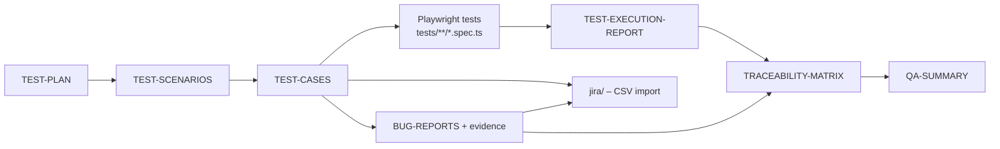

# QA Documentation

This folder holds the complete manual-QA documentation for the PetClinic project. The
documents follow the usual QA life cycle; read them in this order:

| # | Document | What it answers |
|---|---|---|
| 1 | [TEST-PLAN.md](TEST-PLAN.md) | What is tested, how, on which browsers, with which entry/exit criteria and risks (test strategy and plan) |
| 2 | [TEST-DATA.md](TEST-DATA.md) | How test data is named, created and cleaned up so pre-existing data is never changed |
| 3 | [TEST-SCENARIOS.md](TEST-SCENARIOS.md) | 39 high-level scenarios (Jira Stories) and 14 recommended, not-yet-implemented tests |
| 4 | [TEST-CASES.md](TEST-CASES.md) | 123 detailed test cases with preconditions, data, steps and expected results |
| 5 | [TEST-COVERAGE.md](TEST-COVERAGE.md) | Feature → test case matrix, test types per module, what is not covered |
| 6 | [BUG-REPORTS.md](BUG-REPORTS.md) | 17 confirmed bugs and 5 observations, with evidence in [`evidence/`](evidence) |
| 7 | [TEST-EXECUTION-REPORT.md](TEST-EXECUTION-REPORT.md) | Results of the full run on 2026-11-02 (209 runs, 5 browser/device projects) |
| 8 | [TRACEABILITY-MATRIX.md](TRACEABILITY-MATRIX.md) | Feature → scenario → test case → Playwright test → result → bug ([CSV](TRACEABILITY-MATRIX.csv)) |
| 9 | [QA-SUMMARY.md](QA-SUMMARY.md) | Final QA summary: results, defects, risks, recommendations |
| 10 | [jira/](jira/README.md) | Jira project structure, CSV import file and issue ↔ repository mapping |

## How the documents connect

## ID conventions

| ID | Example | Used in |
|---|---|---|
| Area code | `OWN` (Owners) | Epics, folders under `tests/`, every ID below |
| Scenario | `OWN-S02` | TEST-SCENARIOS, Jira Story |
| Test case | `OWN-002` | TEST-CASES, **the Playwright test title**, Jira test-case summary |
| Bug | `BUG-009` | BUG-REPORTS, `issue` annotation of the known-bug test, Jira Bug |
| Observation | `OBS-001` | BUG-REPORTS, Jira Task |
| Execution | `TE-001` | TEST-EXECUTION-REPORT, Jira Task |
| Recommended test | `REC-001` | TEST-SCENARIOS, Jira Task (not implemented) |

Area codes: `NAV` Navigation · `OWN` Owners · `PET` Pets · `VIS` Visits · `VET` Veterinarians ·
`PTY` Pet Types · `SPC` Specialties · `REG` Regression · `API` REST API · `SEC` Security ·
`A11Y` Accessibility · `RSP` Responsive / cross-browser.

## Status legend

| Term | Meaning |
|---|---|
| **Automated** | A Playwright test exists and runs in the suite |
| **Automated – known bug** | The test asserts the correct behaviour and is marked as an expected failure while the bug is open (`knownBug()` in [fixtures/index.ts](../fixtures/index.ts)) |
| **Exploratory** | No requirement defines the result; the automated test records what happened |
| **Manual** | Run by hand only |
| **Recommended** | Proposed coverage – **not implemented, not executed** |

Execution results are only ever taken from real runs (currently the 2026-11-02 run). A test that
has not been run is marked *Not Executed*.
