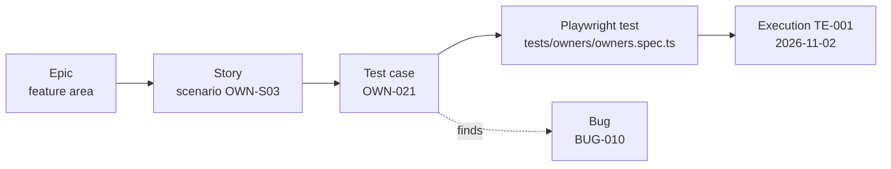

# Requirements Traceability Matrix – PetClinic QA

| | |
|---|---|
| **Related** | [TEST-SCENARIOS.md](TEST-SCENARIOS.md) · [TEST-CASES.md](TEST-CASES.md) · [BUG-REPORTS.md](BUG-REPORTS.md) · [CSV version](TRACEABILITY-MATRIX.csv) |
| **Date** | 2026-11-03 |
| **Source of truth** | Playwright tests in [`tests/`](../tests) and [TEST-CASES.md](TEST-CASES.md) at commit `63be3b5`; results from [TEST-EXECUTION-REPORT.md](TEST-EXECUTION-REPORT.md) (run of 2026-11-02) |

Traces every **feature → scenario (Jira Story) → test case (Jira test) → Playwright test →
execution → bug**. The same IDs are used everywhere: the Playwright test title starts with the
test case ID, the Jira summary starts with the same ID, and known-bug tests carry the bug ID as
an `issue` annotation in the Playwright report.

Execution results come only from the 2026-11-02 run (execution **TE-001**, see
[TEST-EXECUTION-REPORT.md](TEST-EXECUTION-REPORT.md)). Nothing here was re-run.

## Coverage by feature

| Feature | Test cases | Automated | Manual | Passed | Failed (bug) | Observation | Not executed | Bugs |
|---|---|---|---|---|---|---|---|---|
| Navigation | 8 | 8 | 0 | 7 | 1 | 0 | 0 | BUG-007 |
| Owners | 21 | 21 | 0 | 17 | 2 | 2 | 0 | BUG-002, BUG-010 |
| Pets | 14 | 14 | 0 | 10 | 3 | 1 | 0 | BUG-001, BUG-004, BUG-005 |
| Visits | 11 | 11 | 0 | 8 | 2 | 1 | 0 | BUG-003, BUG-004 |
| Veterinarians | 11 | 11 | 0 | 8 | 3 | 0 | 0 | BUG-004, BUG-005, BUG-006 |
| Pet Types | 10 | 10 | 0 | 7 | 1 | 2 | 0 | BUG-009 |
| Specialties | 8 | 8 | 0 | 7 | 1 | 0 | 0 | BUG-004 |
| Regression / Cross-Module Consistency | 6 | 6 | 0 | 6 | 0 | 0 | 0 | – |
| REST API | 18 | 18 | 0 | 18 | 0 | 0 | 0 | – |
| Security (non-invasive) | 5 | 4 | 1 | 3 | 1 | 0 | 1 | BUG-008 |
| Accessibility | 7 | 5 | 2 | 1 | 4 | 0 | 2 | BUG-011, BUG-012, BUG-013, BUG-014, BUG-015, BUG-016 |
| Responsive / Cross-Browser | 4 | 4 | 0 | 3 | 1 | 0 | 0 | BUG-017 |
| **Total** | **123** | **120** | **3** | **95** | **19** | **6** | **3** | **17** |

## Matrix

### Navigation

| Scenario | Test case | Title | Priority | Playwright test | Automation | Result (TE-001) | Bugs |
|---|---|---|---|---|---|---|---|
| NAV-S01 | NAV-001 | Home page shows the welcome message | High | [homework.spec.ts:7](../tests/homework.spec.ts#L7) | Automated | Passed | – |
| NAV-S01 | NAV-002 | Top-level navbar links open the correct pages | High | [navigation/navigation.spec.ts:17](../tests/navigation/navigation.spec.ts#L17) | Automated | Passed | – |
| NAV-S01 | NAV-003 | Owners dropdown opens Search and Add New | High | [navigation/navigation.spec.ts:31](../tests/navigation/navigation.spec.ts#L31) | Automated | Passed | – |
| NAV-S01 | NAV-004 | Veterinarians dropdown opens All and Add New | High | [navigation/navigation.spec.ts:41](../tests/navigation/navigation.spec.ts#L41) | Automated | Passed | – |
| NAV-S02 | NAV-005 | Every route opens directly by URL | Medium | [navigation/navigation.spec.ts:51](../tests/navigation/navigation.spec.ts#L51) | Automated | Passed | – |
| NAV-S02 | NAV-006 | Unknown URL shows the 404 page | Medium | [navigation/navigation.spec.ts:59](../tests/navigation/navigation.spec.ts#L59) | Automated | Passed | – |
| NAV-S03 | NAV-007 | Browser back and forward keep the right page | Low | [navigation/navigation.spec.ts:68](../tests/navigation/navigation.spec.ts#L68) | Automated | Passed | – |
| NAV-S03 | NAV-008 | Each page has a descriptive title | Low | [navigation/navigation.spec.ts:80](../tests/navigation/navigation.spec.ts#L80) | Automated (known-bug test) | Failed (confirmed bug) | [BUG-007](BUG-REPORTS.md#bug-007) |

### Owners

| Scenario | Test case | Title | Priority | Playwright test | Automation | Result (TE-001) | Bugs |
|---|---|---|---|---|---|---|---|
| OWN-S01 | OWN-001 | Owner list shows all owners with the expected columns | High | [owners/owners.spec.ts:13](../tests/owners/owners.spec.ts#L13) | Automated | Passed | – |
| OWN-S02 | OWN-002 | Search by full last name finds only matching owners | High | [owners/owners.spec.ts:23](../tests/owners/owners.spec.ts#L23) | Automated | Passed | – |
| OWN-S02 | OWN-003 | Search is case-insensitive | Medium | [owners/owners.spec.ts:36](../tests/owners/owners.spec.ts#L36) | Automated | Passed | – |
| OWN-S02 | OWN-004 | Search matches the start of the last name | Medium | [owners/owners.spec.ts:45](../tests/owners/owners.spec.ts#L45) | Automated | Passed | – |
| OWN-S02 | OWN-005 | Search with no match shows a message | Medium | [owners/owners.spec.ts:57](../tests/owners/owners.spec.ts#L57) | Automated | Passed | – |
| OWN-S02 | OWN-006 | Search with surrounding spaces | Low | [exploratory/exploratory.spec.ts:25](../tests/exploratory/exploratory.spec.ts#L25) | Automated (exploratory) | Observation recorded | – |
| OWN-S02 | OWN-007 | Empty search lists all owners | Medium | [owners/owners.spec.ts:67](../tests/owners/owners.spec.ts#L67) | Automated | Passed | – |
| OWN-S03 | OWN-008 | Create an owner with valid data | Critical | [owners/owners.spec.ts:80](../tests/owners/owners.spec.ts#L80) | Automated | Passed | – |
| OWN-S03 | OWN-009 | Add Owner stays disabled until the form is valid | High | [owners/owners.spec.ts:99](../tests/owners/owners.spec.ts#L99) | Automated | Passed | – |
| OWN-S03 | OWN-010 | Required-field messages on New Owner | High | [owners/owners.spec.ts:118](../tests/owners/owners.spec.ts#L118) | Automated | Passed | – |
| OWN-S03 | OWN-011 | First name minimum length (boundary) | Medium | [owners/owners.spec.ts:128](../tests/owners/owners.spec.ts#L128) | Automated | Passed | – |
| OWN-S03 | OWN-012 | Telephone rejects non-digits | Medium | [owners/owners.spec.ts:145](../tests/owners/owners.spec.ts#L145) | Automated | Passed | – |
| OWN-S03 | OWN-013 | Telephone maximum length (boundary) | Medium | [owners/owners.spec.ts:160](../tests/owners/owners.spec.ts#L160) | Automated | Passed | – |
| OWN-S03 | OWN-014 | Telephone with very few digits | Low | [exploratory/exploratory.spec.ts:35](../tests/exploratory/exploratory.spec.ts#L35) | Automated (exploratory) | Observation recorded | – |
| OWN-S04 | OWN-015 | Owner details show pets and visits | High | [owners/owners.spec.ts:217](../tests/owners/owners.spec.ts#L217) | Automated | Passed | – |
| OWN-S05 | OWN-016 | Edit an owner | High | [owners/owners.spec.ts:239](../tests/owners/owners.spec.ts#L239) | Automated | Passed | – |
| OWN-S05 | OWN-017 | Edit Owner validation | Medium | [owners/owners.spec.ts:257](../tests/owners/owners.spec.ts#L257) | Automated | Passed | – |
| OWN-S05 | OWN-018 | Back on Edit Owner discards changes | Medium | [owners/owners.spec.ts:272](../tests/owners/owners.spec.ts#L272) | Automated | Passed | – |
| OWN-S03 | OWN-019 | Back on New Owner creates nothing | Medium | [owners/owners.spec.ts:170](../tests/owners/owners.spec.ts#L170) | Automated | Passed | – |
| OWN-S04 | OWN-020 | Non-existent owner ID shows an error | Medium | [owners/owners.spec.ts:286](../tests/owners/owners.spec.ts#L286) | Automated (known-bug test) | Failed (confirmed bug) | [BUG-002](BUG-REPORTS.md#bug-002) |
| OWN-S03 | OWN-021 | Special characters, Unicode and long values in owner fields | Medium | [owners/owners.spec.ts:193](../tests/owners/owners.spec.ts#L193) | Automated (known-bug test) | Failed (confirmed bug) | [BUG-010](BUG-REPORTS.md#bug-010) |

### Pets

| Scenario | Test case | Title | Priority | Playwright test | Automation | Result (TE-001) | Bugs |
|---|---|---|---|---|---|---|---|
| PET-S01 | PET-001 | Add a pet to an owner | Critical | [pets/pets.spec.ts:5](../tests/pets/pets.spec.ts#L5) | Automated | Passed | – |
| PET-S01 | PET-002 | Add Pet form shows the owner | Medium | [pets/pets.spec.ts:24](../tests/pets/pets.spec.ts#L24) | Automated | Passed | – |
| PET-S01 | PET-003 | Type dropdown lists all pet types | High | [pets/pets.spec.ts:35](../tests/pets/pets.spec.ts#L35) | Automated | Passed | – |
| PET-S01 | PET-004 | Required-field messages on Add Pet | Medium | [pets/pets.spec.ts:46](../tests/pets/pets.spec.ts#L46) | Automated | Passed | – |
| PET-S01 | PET-005 | Save Pet on an empty form gives feedback | Low | [pets/pets.spec.ts:61](../tests/pets/pets.spec.ts#L61) | Automated (known-bug test) | Failed (confirmed bug) | [BUG-005](BUG-REPORTS.md#bug-005) |
| PET-S01 | PET-006 | Birth date entered by typing | Medium | [pets/pets.spec.ts:75](../tests/pets/pets.spec.ts#L75) | Automated | Passed | – |
| PET-S01 | PET-007 | Birth date in the future | Low | [exploratory/exploratory.spec.ts:50](../tests/exploratory/exploratory.spec.ts#L50) | Automated (exploratory) | Observation recorded | – |
| PET-S02 | PET-008 | Edit a pet | High | [pets/pets.spec.ts:105](../tests/pets/pets.spec.ts#L105) | Automated | Passed | – |
| PET-S02 | PET-009 | Edit Pet form is pre-filled | Medium | [pets/pets.spec.ts:122](../tests/pets/pets.spec.ts#L122) | Automated | Passed | – |
| PET-S02 | PET-010 | Back on Edit Pet returns to the owner | Medium | [pets/pets.spec.ts:135](../tests/pets/pets.spec.ts#L135) | Automated (known-bug test) | Failed (confirmed bug) | [BUG-001](BUG-REPORTS.md#bug-001) |
| PET-S01 | PET-011 | Back on Add Pet creates nothing | Medium | [pets/pets.spec.ts:91](../tests/pets/pets.spec.ts#L91) | Automated | Passed | – |
| PET-S03 | PET-012 | Delete a pet | High | [pets/pets.spec.ts:149](../tests/pets/pets.spec.ts#L149) | Automated | Passed | – |
| PET-S03 | PET-013 | Deleting a pet asks for confirmation | Medium | [pets/pets.spec.ts:161](../tests/pets/pets.spec.ts#L161) | Automated (known-bug test) | Failed (confirmed bug) | [BUG-004](BUG-REPORTS.md#bug-004) |
| PET-S03 | PET-014 | Delete a pet that has visits | Medium | [pets/pets.spec.ts:178](../tests/pets/pets.spec.ts#L178) | Automated | Passed | – |

### Visits

| Scenario | Test case | Title | Priority | Playwright test | Automation | Result (TE-001) | Bugs |
|---|---|---|---|---|---|---|---|
| VIS-S01 | VIS-001 | Add a visit | Critical | [visits/visits.spec.ts:5](../tests/visits/visits.spec.ts#L5) | Automated | Passed | – |
| VIS-S01 | VIS-002 | New Visit page shows the pet | Medium | [visits/visits.spec.ts:23](../tests/visits/visits.spec.ts#L23) | Automated | Passed | – |
| VIS-S01 | VIS-003 | New Visit page lists previous visits | Medium | [visits/visits.spec.ts:34](../tests/visits/visits.spec.ts#L34) | Automated | Passed | – |
| VIS-S01 | VIS-004 | Description is required | Medium | [visits/visits.spec.ts:45](../tests/visits/visits.spec.ts#L45) | Automated | Passed | – |
| VIS-S01 | VIS-005 | Empty New Visit form is not submitted | Medium | [visits/visits.spec.ts:58](../tests/visits/visits.spec.ts#L58) | Automated (known-bug test) | Failed (confirmed bug) | [BUG-003](BUG-REPORTS.md#bug-003) |
| VIS-S01 | VIS-006 | Date given, description empty | Medium | [visits/visits.spec.ts:73](../tests/visits/visits.spec.ts#L73) | Automated | Passed | – |
| VIS-S02 | VIS-007 | Edit a visit | High | [visits/visits.spec.ts:103](../tests/visits/visits.spec.ts#L103) | Automated | Passed | – |
| VIS-S03 | VIS-008 | Delete a visit | High | [visits/visits.spec.ts:120](../tests/visits/visits.spec.ts#L120) | Automated | Passed | – |
| VIS-S03 | VIS-009 | Deleting a visit asks for confirmation | Medium | [visits/visits.spec.ts:133](../tests/visits/visits.spec.ts#L133) | Automated (known-bug test) | Failed (confirmed bug) | [BUG-004](BUG-REPORTS.md#bug-004) |
| VIS-S01 | VIS-010 | Back on New Visit returns to the owner | Medium | [visits/visits.spec.ts:88](../tests/visits/visits.spec.ts#L88) | Automated | Passed | – |
| VIS-S01 | VIS-011 | Visit date edge values | Low | [exploratory/exploratory.spec.ts:66](../tests/exploratory/exploratory.spec.ts#L66) | Automated (exploratory) | Observation recorded | – |

### Veterinarians

| Scenario | Test case | Title | Priority | Playwright test | Automation | Result (TE-001) | Bugs |
|---|---|---|---|---|---|---|---|
| VET-S01 | VET-001 | Vet list shows names and specialties | High | [vets/vets.spec.ts:5](../tests/vets/vets.spec.ts#L5) | Automated | Passed | – |
| VET-S02 | VET-002 | Create a vet with a specialty | High | [vets/vets.spec.ts:23](../tests/vets/vets.spec.ts#L23) | Automated | Passed | – |
| VET-S02 | VET-003 | Create a vet without a specialty | Medium | [vets/vets.spec.ts:37](../tests/vets/vets.spec.ts#L37) | Automated | Passed | – |
| VET-S02 | VET-004 | Required-field messages on New Veterinarian | Medium | [vets/vets.spec.ts:50](../tests/vets/vets.spec.ts#L50) | Automated | Passed | – |
| VET-S02 | VET-005 | Save Vet on an empty form gives feedback | Low | [vets/vets.spec.ts:63](../tests/vets/vets.spec.ts#L63) | Automated (known-bug test) | Failed (confirmed bug) | [BUG-005](BUG-REPORTS.md#bug-005) |
| VET-S02 | VET-006 | New Veterinarian specialty field matches Edit Vet | Low | [vets/vets.spec.ts:77](../tests/vets/vets.spec.ts#L77) | Automated (known-bug test) | Failed (confirmed bug) | [BUG-006](BUG-REPORTS.md#bug-006) |
| VET-S03 | VET-007 | Edit a vet's names and specialties | High | [vets/vets.spec.ts:92](../tests/vets/vets.spec.ts#L92) | Automated | Passed | – |
| VET-S03 | VET-008 | Edit Vet validation | Medium | [vets/vets.spec.ts:113](../tests/vets/vets.spec.ts#L113) | Automated | Passed | – |
| VET-S04 | VET-009 | Delete a vet | High | [vets/vets.spec.ts:128](../tests/vets/vets.spec.ts#L128) | Automated | Passed | – |
| VET-S04 | VET-010 | Deleting a vet asks for confirmation | Medium | [vets/vets.spec.ts:138](../tests/vets/vets.spec.ts#L138) | Automated (known-bug test) | Failed (confirmed bug) | [BUG-004](BUG-REPORTS.md#bug-004) |
| VET-S03 | VET-011 | Back on Edit Vet discards changes | Medium | [vets/vets.spec.ts:153](../tests/vets/vets.spec.ts#L153) | Automated | Passed | – |

### Pet Types

| Scenario | Test case | Title | Priority | Playwright test | Automation | Result (TE-001) | Bugs |
|---|---|---|---|---|---|---|---|
| PTY-S01 | PTY-001 | Pet type list | High | [pet-types/pet-types.spec.ts:12](../tests/pet-types/pet-types.spec.ts#L12) | Automated | Passed | – |
| PTY-S02 | PTY-002 | Add a pet type | High | [pet-types/pet-types.spec.ts:25](../tests/pet-types/pet-types.spec.ts#L25) | Automated | Passed | – |
| PTY-S02 | PTY-003 | Pet type name is required on Add | Medium | [pet-types/pet-types.spec.ts:40](../tests/pet-types/pet-types.spec.ts#L40) | Automated | Passed | – |
| PTY-S03 | PTY-004 | Rename a pet type and rename it back (course assignment) | High | [input-fields.spec.ts:25](../tests/input-fields.spec.ts#L25) | Automated | Passed | – |
| PTY-S03 | PTY-005 | Cancel on Edit Pet Type keeps the name | Medium | [pet-types/pet-types.spec.ts:56](../tests/pet-types/pet-types.spec.ts#L56) | Automated | Passed | – |
| PTY-S03 | PTY-006 | Edit Pet Type with an empty name | Medium | [pet-types/pet-types.spec.ts:68](../tests/pet-types/pet-types.spec.ts#L68) | Automated (exploratory) | Observation recorded | – |
| PTY-S04 | PTY-007 | Delete a pet type after confirming | High | [pet-types/pet-types.spec.ts:84](../tests/pet-types/pet-types.spec.ts#L84) | Automated | Passed | – |
| PTY-S04 | PTY-008 | Cancel the delete confirmation | Medium | [pet-types/pet-types.spec.ts:98](../tests/pet-types/pet-types.spec.ts#L98) | Automated | Passed | – |
| PTY-S02 | PTY-009 | Duplicate pet type name | Low | [pet-types/pet-types.spec.ts:109](../tests/pet-types/pet-types.spec.ts#L109) | Automated (exploratory) | Observation recorded | – |
| PTY-S04 | PTY-010 | Delete a pet type that a pet uses | High | [pet-types/pet-types.spec.ts:122](../tests/pet-types/pet-types.spec.ts#L122) | Automated (known-bug test) | Failed (confirmed bug) | [BUG-009](BUG-REPORTS.md#bug-009) |

### Specialties

| Scenario | Test case | Title | Priority | Playwright test | Automation | Result (TE-001) | Bugs |
|---|---|---|---|---|---|---|---|
| SPC-S01 | SPC-001 | Specialty list | High | [specialties/specialties.spec.ts:8](../tests/specialties/specialties.spec.ts#L8) | Automated | Passed | – |
| SPC-S02 | SPC-002 | Add a specialty | High | [specialties/specialties.spec.ts:21](../tests/specialties/specialties.spec.ts#L21) | Automated | Passed | – |
| SPC-S02 | SPC-003 | Empty specialty name is not saved | Medium | [specialties/specialties.spec.ts:36](../tests/specialties/specialties.spec.ts#L36) | Automated | Passed | – |
| SPC-S03 | SPC-004 | Rename a specialty | High | [specialties/specialties.spec.ts:51](../tests/specialties/specialties.spec.ts#L51) | Automated | Passed | – |
| SPC-S03 | SPC-005 | Cancel on Edit Specialty keeps the name | Medium | [specialties/specialties.spec.ts:62](../tests/specialties/specialties.spec.ts#L62) | Automated | Passed | – |
| SPC-S04 | SPC-006 | Delete a specialty | High | [specialties/specialties.spec.ts:74](../tests/specialties/specialties.spec.ts#L74) | Automated | Passed | – |
| SPC-S04 | SPC-007 | Deleting a specialty asks for confirmation | Medium | [specialties/specialties.spec.ts:84](../tests/specialties/specialties.spec.ts#L84) | Automated (known-bug test) | Failed (confirmed bug) | [BUG-004](BUG-REPORTS.md#bug-004) |
| SPC-S04 | SPC-008 | Delete a specialty that a vet has | Medium | [specialties/specialties.spec.ts:99](../tests/specialties/specialties.spec.ts#L99) | Automated | Passed | – |

### Regression / Cross-Module Consistency

| Scenario | Test case | Title | Priority | Playwright test | Automation | Result (TE-001) | Bugs |
|---|---|---|---|---|---|---|---|
| REG-S01 | REG-001 | Renamed pet type appears everywhere | High | [regression/consistency.spec.ts:4](../tests/regression/consistency.spec.ts#L4) | Automated | Passed | – |
| REG-S01 | REG-002 | New specialty is offered in the vet forms | High | [regression/consistency.spec.ts:26](../tests/regression/consistency.spec.ts#L26) | Automated | Passed | – |
| REG-S01 | REG-003 | Renamed specialty appears in the vet list | Medium | [regression/consistency.spec.ts:39](../tests/regression/consistency.spec.ts#L39) | Automated | Passed | – |
| REG-S01 | REG-004 | Edited owner appears in list and search | High | [regression/consistency.spec.ts:52](../tests/regression/consistency.spec.ts#L52) | Automated | Passed | – |
| REG-S02 | REG-005 | End-to-end clinic workflow | Critical | [regression/consistency.spec.ts:70](../tests/regression/consistency.spec.ts#L70) | Automated | Passed | – |
| REG-S01 | REG-006 | Data survives a full page reload | Medium | [regression/consistency.spec.ts:111](../tests/regression/consistency.spec.ts#L111) | Automated | Passed | – |

### REST API

| Scenario | Test case | Title | Priority | Playwright test | Automation | Result (TE-001) | Bugs |
|---|---|---|---|---|---|---|---|
| API-S01 | API-001 | List owners | High | [api/api.spec.ts:9](../tests/api/api.spec.ts#L9) | Automated | Passed | – |
| API-S01 | API-002 | Search owners by last name | Medium | [api/api.spec.ts:28](../tests/api/api.spec.ts#L28) | Automated | Passed | – |
| API-S01 | API-003 | Owner search without a match (current behaviour: 404) | Low | [api/api.spec.ts:40](../tests/api/api.spec.ts#L40) | Automated | Passed | – |
| API-S01 | API-004 | Create, read and delete an owner | High | [api/api.spec.ts:51](../tests/api/api.spec.ts#L51) | Automated | Passed | – |
| API-S01 | API-005 | Update an owner | Medium | [api/api.spec.ts:68](../tests/api/api.spec.ts#L68) | Automated | Passed | – |
| API-S01 | API-006 | Unknown owner ID | Medium | [api/api.spec.ts:78](../tests/api/api.spec.ts#L78) | Automated | Passed | – |
| API-S02 | API-007 | Create a pet for an owner | High | [api/api.spec.ts:84](../tests/api/api.spec.ts#L84) | Automated | Passed | – |
| API-S02 | API-008 | Update and delete a pet | Medium | [api/api.spec.ts:99](../tests/api/api.spec.ts#L99) | Automated | Passed | – |
| API-S02 | API-009 | Create, update and delete a visit | Medium | [api/api.spec.ts:111](../tests/api/api.spec.ts#L111) | Automated | Passed | – |
| API-S02 | API-010 | Visit with an invalid date is rejected | Medium | [api/api.spec.ts:129](../tests/api/api.spec.ts#L129) | Automated | Passed | – |
| API-S03 | API-011 | Pet type CRUD | Medium | [api/api.spec.ts:143](../tests/api/api.spec.ts#L143) | Automated | Passed | – |
| API-S03 | API-012 | Specialty CRUD | Medium | [api/api.spec.ts:143](../tests/api/api.spec.ts#L143) | Automated | Passed | – |
| API-S03 | API-013 | Vet CRUD with specialties | Medium | [api/api.spec.ts:161](../tests/api/api.spec.ts#L161) | Automated | Passed | – |
| API-S03 | API-014 | Missing required fields are rejected | Medium | [api/api.spec.ts:187](../tests/api/api.spec.ts#L187) | Automated | Passed | – |
| API-S04 | API-015 | Requests without a token are rejected | High | [api/api.spec.ts:197](../tests/api/api.spec.ts#L197) | Automated | Passed | – |
| API-S04 | API-016 | Requests with an invalid token are rejected | High | [api/api.spec.ts:210](../tests/api/api.spec.ts#L210) | Automated | Passed | – |
| API-S04 | API-017 | UI and API show the same data | Medium | [api/api.spec.ts:219](../tests/api/api.spec.ts#L219) | Automated | Passed | – |
| API-S04 | API-018 | Response times are reasonable | Low | [api/api.spec.ts:235](../tests/api/api.spec.ts#L235) | Automated | Passed | – |

### Security (non-invasive)

| Scenario | Test case | Title | Priority | Playwright test | Automation | Result (TE-001) | Bugs |
|---|---|---|---|---|---|---|---|
| SEC-S01 | SEC-001 | Script-like input in owner fields is shown as text | High | [security/security.spec.ts:22](../tests/security/security.spec.ts#L22) | Automated | Passed | – |
| SEC-S01 | SEC-002 | Script-like input in names of other entities | Medium | [security/security.spec.ts:44](../tests/security/security.spec.ts#L44) | Automated | Passed | – |
| SEC-S02 | SEC-003 | Access token is sent only to the API | High | [security/security.spec.ts:65](../tests/security/security.spec.ts#L65) | Automated | Passed | – |
| SEC-S02 | SEC-004 | API errors do not leak internal details | Medium | [security/security.spec.ts:93](../tests/security/security.spec.ts#L93) | Automated (known-bug test) | Failed (confirmed bug) | [BUG-008](BUG-REPORTS.md#bug-008) |
| SEC-S02 | SEC-005 | No credentials or tokens in the repository or reports | Medium | – (manual) | Manual | Not Executed | – |

### Accessibility

| Scenario | Test case | Title | Priority | Playwright test | Automation | Result (TE-001) | Bugs |
|---|---|---|---|---|---|---|---|
| A11Y-S01 | A11Y-001 | Automated axe scan of every main page | Medium | [accessibility/accessibility.spec.ts:84](../tests/accessibility/accessibility.spec.ts#L84) | Automated (known-bug test) | Failed (confirmed bug) | [BUG-011](BUG-REPORTS.md#bug-011), [BUG-012](BUG-REPORTS.md#bug-012), [BUG-014](BUG-REPORTS.md#bug-014), [BUG-016](BUG-REPORTS.md#bug-016) |
| A11Y-S02 | A11Y-002 | Navbar works with the keyboard only | Medium | [accessibility/accessibility.spec.ts:125](../tests/accessibility/accessibility.spec.ts#L125) | Automated (known-bug test) | Failed (confirmed bug) | [BUG-013](BUG-REPORTS.md#bug-013) |
| A11Y-S02 | A11Y-003 | New Owner form can be completed with the keyboard | Medium | [accessibility/accessibility.spec.ts:150](../tests/accessibility/accessibility.spec.ts#L150) | Automated | Passed | – |
| A11Y-S03 | A11Y-004 | Form fields have accessible names | Medium | [accessibility/accessibility.spec.ts:176](../tests/accessibility/accessibility.spec.ts#L176) | Automated (known-bug test) | Failed (confirmed bug) | [BUG-012](BUG-REPORTS.md#bug-012) |
| A11Y-S02 | A11Y-005 | Visible focus indicator | Low | – (manual) | Manual | Not Executed | – |
| A11Y-S02 | A11Y-006 | Date picker works with the keyboard | Low | – (manual) | Manual | Not Executed | – |
| A11Y-S03 | A11Y-007 | Loading indicator has an accessible name | Low | [accessibility/accessibility.spec.ts:204](../tests/accessibility/accessibility.spec.ts#L204) | Automated (known-bug test) | Failed (confirmed bug) | [BUG-015](BUG-REPORTS.md#bug-015) |

### Responsive / Cross-Browser

| Scenario | Test case | Title | Priority | Playwright test | Automation | Result (TE-001) | Bugs |
|---|---|---|---|---|---|---|---|
| RSP-S01 | RSP-001 | Mobile navigation menu | Medium | [responsive/responsive.spec.ts:9](../tests/responsive/responsive.spec.ts#L9) | Automated | Passed | – |
| RSP-S01 | RSP-002 | No horizontal page scroll on tablet and mobile | Low | [responsive/responsive.spec.ts:27](../tests/responsive/responsive.spec.ts#L27) | Automated (known-bug test) | Failed (confirmed bug) | [BUG-017](BUG-REPORTS.md#bug-017) |
| RSP-S02 | RSP-003 | Create an owner on mobile | Medium | @smoke projects in [playwright.config.ts](../playwright.config.ts) | Automated (indirect, @smoke projects) | Passed | – |
| RSP-S02 | RSP-004 | Smoke suite on Firefox, WebKit, tablet and mobile | High | @smoke projects in [playwright.config.ts](../playwright.config.ts) | Automated (indirect, @smoke projects) | Passed | – |

## Bugs → test cases

| Bug | Title | Severity (Jira) | Test cases |
|---|---|---|---|
| [BUG-001](BUG-REPORTS.md#bug-001) | "< Back" on Edit Pet page does nothing | Minor | PET-010 |
| [BUG-002](BUG-REPORTS.md#bug-002) | Non-existent owner ID shows an empty owner page without an error | Minor | OWN-020 |
| [BUG-003](BUG-REPORTS.md#bug-003) | Submitting an empty New Visit form sends an invalid request and fails silently | Minor | VIS-005 |
| [BUG-004](BUG-REPORTS.md#bug-004) | Visits, pets, vets and specialties are deleted without confirmation | Minor | PET-013, VIS-009, VET-010, SPC-007 |
| [BUG-005](BUG-REPORTS.md#bug-005) | Save Pet / Save Vet are enabled on an empty form and submit it anyway | Trivial | PET-005, VET-005 |
| [BUG-006](BUG-REPORTS.md#bug-006) | New Veterinarian form labels the specialty field "Type" and allows only one | Trivial | VET-006 |
| [BUG-007](BUG-REPORTS.md#bug-007) | Every page has the same document title | Trivial | NAV-008 |
| [BUG-008](BUG-REPORTS.md#bug-008) | API error responses expose Java class names and parser messages | Minor | SEC-004 |
| [BUG-009](BUG-REPORTS.md#bug-009) | Deleting a pet type silently deletes every pet of that type and their visits | Critical | PTY-010 |
| [BUG-010](BUG-REPORTS.md#bug-010) | Owners with accented, hyphenated or apostrophe names cannot be saved; no feedback | Minor | OWN-021 |
| [BUG-011](BUG-REPORTS.md#bug-011) | Logo link in the navigation bar has no accessible name | Trivial | A11Y-001 |
| [BUG-012](BUG-REPORTS.md#bug-012) | Form fields have no label or accessible name | Minor | A11Y-001, A11Y-004 |
| [BUG-013](BUG-REPORTS.md#bug-013) | Owners and Veterinarians menus cannot be reached with the keyboard | Major | A11Y-002 |
| [BUG-014](BUG-REPORTS.md#bug-014) | Owner details: invalid definition list structure | Trivial | A11Y-001 |
| [BUG-015](BUG-REPORTS.md#bug-015) | Loading spinner has no accessible name | Trivial | A11Y-007 |
| [BUG-016](BUG-REPORTS.md#bug-016) | Owner name links in the owner list have too little colour contrast | Trivial | A11Y-001 |
| [BUG-017](BUG-REPORTS.md#bug-017) | New Visit page is wider than phone screens (horizontal scrolling) | Minor | RSP-002 |

## Features that still need manual testing

| Area | Gap | Covered by |
|---|---|---|
| Accessibility | Visible focus indicator, date picker with the keyboard | Manual cases A11Y-005, A11Y-006 (not executed yet) |
| Security | Secrets in repository and reports | Manual case SEC-005 (checked during the 2026-11-03 analysis, not as a formal run) |
| Sign-in / sign-out, session expiry | Not tested (third-party identity provider, one account) | Recommended REC-001, REC-002 |
| Screen reader, 200 % zoom | Not tested | Recommended REC-003, REC-004, REC-014 |
| Functional suite on Firefox / WebKit | Only `@smoke` runs there | Recommended REC-005 |

Full list of proposed tests: [TEST-SCENARIOS.md § Recommended additional coverage](TEST-SCENARIOS.md#recommended-additional-coverage).
