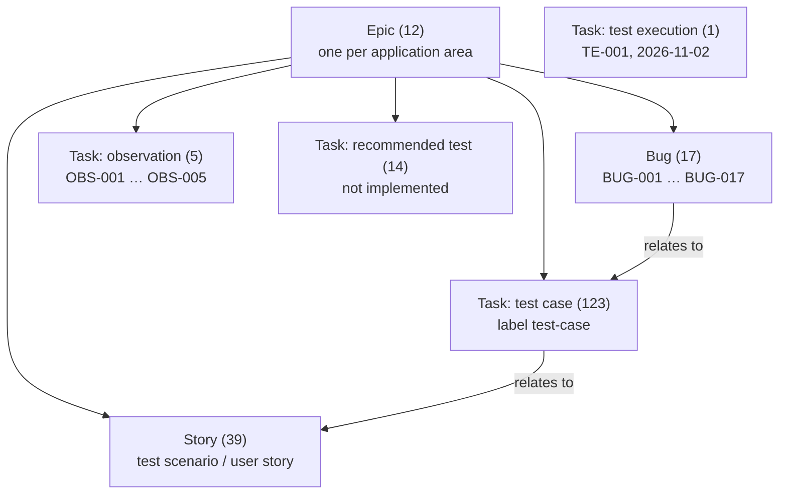

# Jira – QA Project Structure (QAPORT)

| | |
|---|---|
| **Jira project** | *Playwright Automation & Manual QA Portfolio*, key `QAPORT` (team-managed Jira Software project) |
| **How it was built** | Generated from this repository and imported with Jira's CSV importer – see [IMPORT-GUIDE.md](IMPORT-GUIDE.md) |
| **Files** | [QAPORT-Jira-Import.csv](QAPORT-Jira-Import.csv) (import file) · [jira-issue-mapping.csv](jira-issue-mapping.csv) (every issue ↔ repository file) |
| **Add-ons** | None. Xray / Zephyr are paid and were not used; test cases are Jira Tasks labelled `test-case` |

The Jira project itself is private. Everything it contains is in this folder and in the
documents it links to, so the work can be reviewed without Jira access.

## Issue hierarchy

| Jira item | Count | Repository source |
|---|---|---|
| Epic | 12 | Areas in [TEST-PLAN.md §2](../TEST-PLAN.md#2-scope) |
| Story (scenario) | 39 | [TEST-SCENARIOS.md](../TEST-SCENARIOS.md) |
| Task – test case | 123 | [TEST-CASES.md](../TEST-CASES.md) and the Playwright tests in [`tests/`](../../tests) |
| Bug | 17 | [BUG-REPORTS.md](../BUG-REPORTS.md) with evidence in [`docs/evidence/`](../evidence) |
| Task – observation | 5 | [BUG-REPORTS.md § Observations](../BUG-REPORTS.md#observations-not-filed-as-bugs) |
| Task – test execution | 1 | [TEST-EXECUTION-REPORT.md](../TEST-EXECUTION-REPORT.md) |
| Task – recommended test | 14 | [TEST-SCENARIOS.md § Recommended](../TEST-SCENARIOS.md#recommended-additional-coverage) |
| **Total** | **211** | |

## Epics

| Epic | Scope | Test cases |
|---|---|---|
| Navigation | Navigation bar, home page, direct URL access, 404 page, browser history and page titles. | 8 |
| Owners | Owner list, search by last name, create, view details and edit. (Deleting owners is not offered in the UI.) | 21 |
| Pets | Add, edit and delete pets from the owner details page; pet type dropdown; birth date input. | 14 |
| Visits | Add, edit and delete visits; previous-visits list; visit form validation. | 11 |
| Veterinarians | Vet list, create, edit (multiple specialties) and delete. | 11 |
| Pet Types | Pet type list, inline add, edit, delete with confirmation, and the effect of deleting a type in use. | 10 |
| Specialties | Specialty list, inline add, edit, delete, and the effect on vets. | 8 |
| Regression / Cross-Module Consistency | Changes in one module reflected in every other module; end-to-end clinic workflow; data persistence after reload. | 6 |
| REST API | PetClinic REST API: status codes, response structure, invalid input, authentication, UI/API consistency and a basic response-time check. | 18 |
| Security (non-invasive) | Script injection rendered as text, token scope, error-message exposure, secrets in the repository. No attack traffic or penetration testing. | 5 |
| Accessibility | Automated axe-core WCAG 2.1 A/AA scans, keyboard navigation, accessible names, focus visibility. | 7 |
| Responsive / Cross-Browser | Tablet (iPad gen 7) and mobile (Pixel 7) layouts, and the smoke suite on Firefox, WebKit, tablet and mobile. | 4 |

## Naming conventions

| Item | Format | Example |
|---|---|---|
| Epic | Area name | `Owners` |
| Story | `<AREA>-S<nn> · <feature>` | `OWN-S02 · Search owners by last name` |
| Test case | `<AREA>-<nnn> · <title>` – same ID as the Playwright test title | `OWN-002 · Search by full last name finds only matching owners` |
| Bug | `BUG-<nnn> · <title>` | `BUG-009 · Deleting a pet type silently deletes every pet of that type and their visits` |
| Observation | `OBS-<nnn> · <title>` | `OBS-001 · Owner search without a match returns HTTP 404 …` |
| Test execution | `TE-<nnn> · <run>` | `TE-001 · Full regression execution – 2026-11-02` |
| Recommended test | `REC-<nnn> · <title> (recommended)` | `REC-001 · Sign in with valid credentials and sign out (recommended)` |

## Fields and labels

* **Priority** (test cases): Critical → Highest, High → High, Medium → Medium, Low → Low.
* **Bug severity** (in the description and as label `severity-*`): BUG-009 **Critical**; the
  others map from the original report as High → Major, Medium → Minor, Low → Trivial.
* **Execution status** labels: `exec-passed`, `exec-failed`, `exec-observation-recorded`, `exec-not-executed`.
* **Automation** labels: `automated`, `manual`, `exploratory`, `known-bug`, `smoke`, `indirect-coverage`.
* **Area** labels: `module-nav`, `module-own`, `module-pet`, … ; **type** labels: `type-functional`, `type-negative`, `type-api`, …

Each test-case description contains: Test Case ID, Title, Epic/Feature, User Story, Testing Type,
Priority, Preconditions, Test Data, Test Steps, Expected Results, Actual Results, Execution
Status, Automation Status, Automation Reference (Playwright file and line on GitHub),
Environment and Notes.

## Useful Jira filters (JQL)

| Purpose | JQL |
|---|---|
| All test cases | `project = QAPORT AND labels = test-case` |
| Failed because of a bug | `project = QAPORT AND labels = test-case AND labels = exec-failed` |
| Manual test cases | `project = QAPORT AND labels = test-case AND labels = manual` |
| Open bugs by severity | `project = QAPORT AND type = Bug ORDER BY priority DESC` |
| Coverage gaps | `project = QAPORT AND labels = recommended-coverage` |
